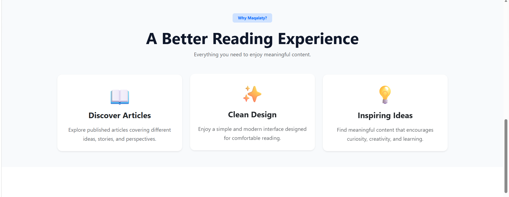
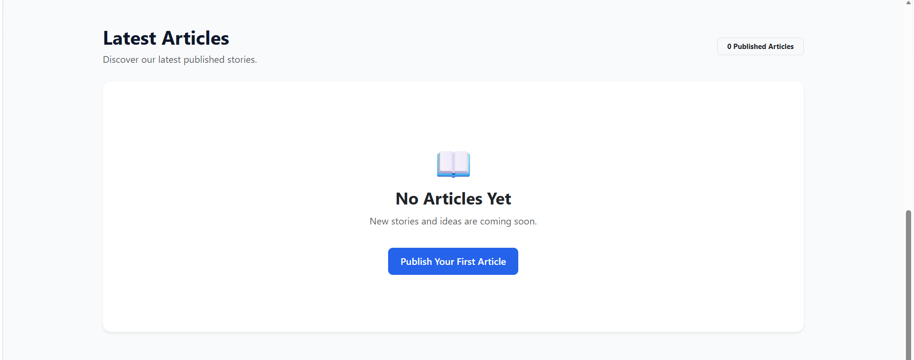
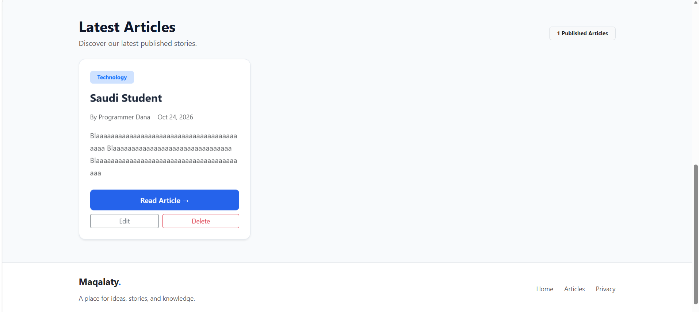
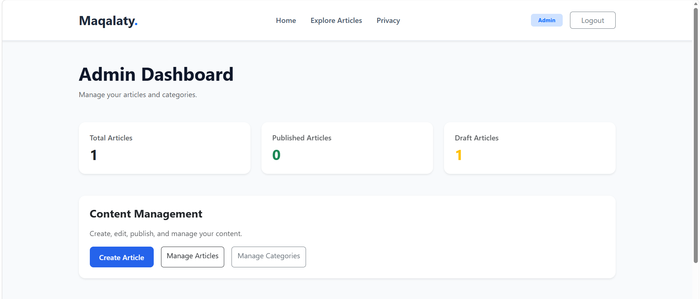

# Maqalaty | Article Publishing Platform

A full-stack article publishing platform developed using **ASP.NET Core MVC, C#, Entity Framework Core, and SQL Server**.

Maqalaty enables visitors to explore published articles while providing administrators with a secure dashboard to manage articles, drafts, and categories.

The project was independently developed to demonstrate practical software engineering skills, including MVC architecture, database design, authentication, authorization, and maintainable application development.

---

## Features

### Article Management
- Create, edit, and delete articles.
- Save articles as drafts or publish them.
- Display published articles to visitors.
- View individual article details.
- Search articles by title.
- Filter articles by category.
- Combine article search and category filtering.

### Admin Dashboard
- View article statistics.
- Manage published articles and drafts.
- Create and delete categories.
- Prevent duplicate category names.
- Manage content through an administrative interface.

### Authentication and Security
- Authentication using ASP.NET Core Identity.
- Role-based authorization for administrators.
- Secure login and logout.
- Password complexity requirements.
- Account lockout after repeated failed login attempts.
- Anti-forgery protection for form submissions.
- Server-side input validation.

### User Interface
- Responsive layout using Bootstrap.
- Article cards and detailed article pages.
- Search and category filtering interface.
- Administrative dashboard.
- Custom CSS styling.

---

## Technology Stack

| Technology | Purpose |
|---|---|
| C# | Backend development |
| ASP.NET Core MVC (.NET 10) | Web application framework |
| Entity Framework Core | Object-relational mapping |
| SQL Server | Relational database |
| ASP.NET Core Identity | Authentication and authorization |
| Razor Views | Server-rendered user interface |
| HTML & CSS | Page structure and styling |
| Bootstrap | Responsive design |
| Git & GitHub | Version control and source code hosting |

---

## Project Architecture

The application follows the **Model-View-Controller (MVC)** architectural pattern and uses Repository and Service layers to organize article-related business logic and data access.

```text
Maqalaty/
├── Controllers/
├── Data/
├── Migrations/
├── Models/
├── Repositories/
├── Services/
├── ViewModels/
├── Views/
├── wwwroot/
├── Program.cs
├── appsettings.json
└── Maqalaty.csproj
```

### Main Components

**Controllers:** Handle HTTP requests and coordinate application operations.

**Models:** Represent articles, categories, and database entities.

**Repositories:** Encapsulate article data access operations.

**Services:** Provide an abstraction for article-related application operations.

**Data:** Contains the Entity Framework Core database context and category initialization logic.

**ViewModels:** Define models used by application views.

**Views:** Contain Razor pages for visitors and administrators.

---

## Database

The application uses **SQL Server** with **Entity Framework Core Code First**.

The database includes:

- Articles
- Categories
- ASP.NET Core Identity tables

Database schema changes are managed through EF Core Migrations.

Deleting a category does not delete its associated articles.

---

## Getting Started

### Prerequisites

Before running the project, install:

- .NET 10 SDK
- SQL Server LocalDB or a compatible SQL Server instance
- Entity Framework Core CLI tools
- Git

### Installation

**1. Clone the repository**

```bash
git clone <repository-url>
cd Maqalaty
```

Replace `<repository-url>` with the actual GitHub repository URL.

**2. Configure the database**

Update the `DefaultConnection` connection string in `appsettings.json` to match your local SQL Server instance.

**3. Apply database migrations**

```bash
dotnet ef database update
```

**4. Run the application**

```bash
dotnet run --launch-profile https
```

**5. Open the application**

Navigate to the HTTPS address displayed in the terminal.

### Administrator Access

Administrative features require an ASP.NET Core Identity account assigned to the `Admin` role.

Administrator credentials are not included in this repository. An administrator account and role must be configured separately before accessing the dashboard.

---

## Security Considerations

The application includes role-based authorization, anti-forgery protection, input validation, and ASP.NET Core Identity authentication.

Production deployments should use secure environment-specific configuration, HTTPS, and protected database credentials.

---

## Screenshots

### Home Page


### Articles Page


### Article Details


### Admin Dashboard


---

## Project Status

**Status:** Developed and tested locally.

The application includes article publishing, category management, authentication, and an administrative dashboard.

Public deployment has not been configured.

---

## Author

**Dana Almutairi**

Software Engineering Graduate

Developed as an independent software engineering portfolio project.